

<a href="https://arjunajikumar-svg.github.io/">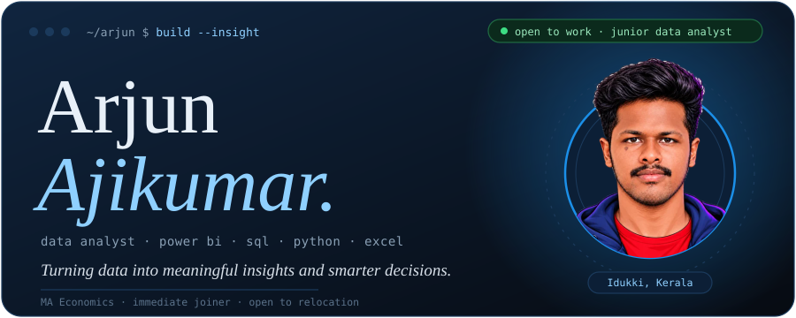</a>

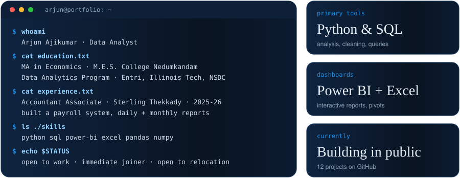

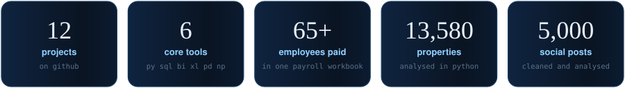

<a href="https://github.com/arjunajikumar-svg/Healthcare-Analysis-">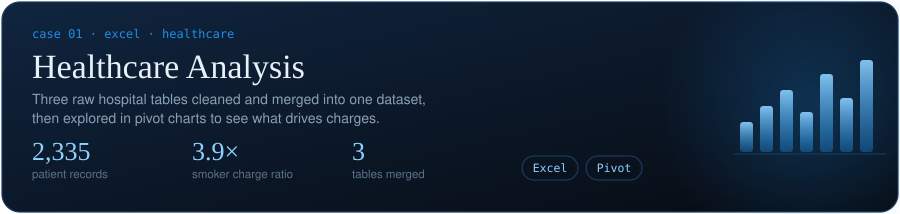</a>

<!-- Add this repo's link around the card below once you have the URL -->
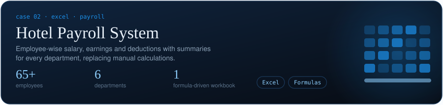

<a href="https://github.com/arjunajikumar-svg/Melbourne-Property-Pricing-Dynamics-An-Exploratory-Analysis">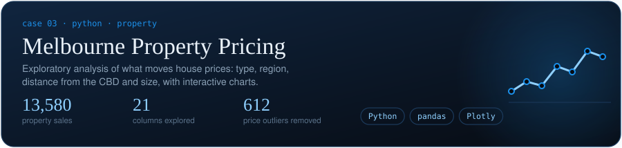</a>

<a href="https://github.com/arjunajikumar-svg/Base-Python-Assignment-">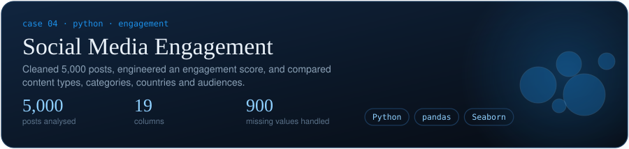</a>

<a href="https://github.com/arjunajikumar-svg/Structured-Sales-Analysis">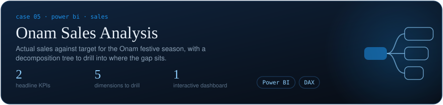</a>

<a href="https://github.com/arjunajikumar-svg/sql-employee-management-system">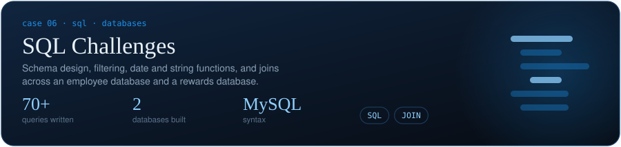</a>

**More on GitHub:** [Excel Dashboard](https://github.com/arjunajikumar-svg/Excel-Dashboard) · [Excel Data Cleaning and Analysis](https://github.com/arjunajikumar-svg/Excel-Data-Cleaning-and-Analysis) · [SQL Employee Rewards System](https://github.com/arjunajikumar-svg/sql-employee-rewards-system) · [NYC Listings Dashboard](https://github.com/arjunajikumar-svg/nyc-listings-dashboard) · [all repositories](https://github.com/arjunajikumar-svg?tab=repositories)

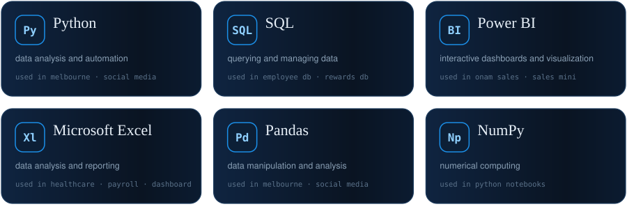

<picture > 
  <source media = "(prefers-color-scheme: dark)" srcset = "https://raw.githubusercontent.com/arjunajikumar-svg/arjunajikumar-svg/output/github-contribution-grid-snake-dark.svg?palette=github-dark" > 
  <source media = "(prefers-color-scheme: light)" srcset = "https://raw.githubusercontent.com/arjunajikumar-svg/arjunajikumar-svg/output/github-contribution-grid-snake.svg" > 
   
</picture>

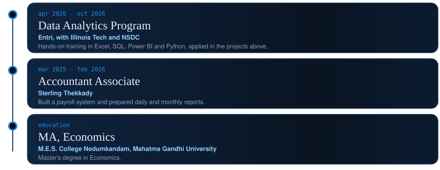

